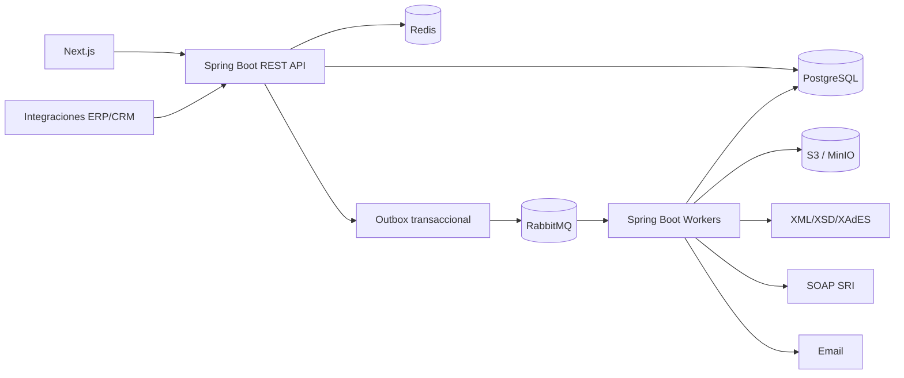

# 03 — Arquitectura de software

## Decisión arquitectónica
**Monolito modular Spring Boot** + workers Spring Boot, **no** microservicios prematuros. API REST modular, PostgreSQL como fuente de verdad, RabbitMQ para comandos asíncronos, Redis como caché/limitador, S3/MinIO para binarios, Next.js como UI.



## Módulos Java (`com.example.einvoice`)
- `identity`: usuarios, roles, sesiones, clientes API.
- `tenancy`: organización, límites, aislamiento, planes.
- `taxpayer`: perfil tributario, establecimientos, puntos, ambientes.
- `certificate`: registro, KMS, rotación, vencimiento.
- `catalog`: clientes, productos, impuestos, métodos de pago.
- `billing`: emisión, líneas, cálculo decimal, documentos relacionados.
- `sequence`: asignación única por RUC/ambiente/tipo/establecimiento/punto. Un RUC pertenece a un solo tenant (doc 04), de modo que existe un único contador por ámbito fiscal.
- `xml`: builders por tipo/versión, validadores XSD, canonicalización donde aplique.
- `signature`: interfaz XAdES, adaptador certificado, verificación.
- `sri`: SOAP recepción/autorización, mapping respuestas.
- `orchestration`: máquina de estados, reintentos, idempotencia, outbox.
- `delivery`: RIDE, email, descarga autenticada.
- `compliance`: retención, reportes, auditoría.

## Contratos e invariantes
1. Una operación fiscal usa siempre tenant + perfil tributario + ambiente + documento.
2. `access_key` es globalmente única; `issuance_number` es único por ámbito fiscal.
3. Nunca regenerar silenciosamente una clave de acceso después de enviar; consultar primero si hay incertidumbre.
4. Una emisión no depende de que SOAP responda durante la petición REST.
5. Persistir factura y evento `outbox` en la misma transacción. Worker consume con deduplicación.
6. `Redis` no almacena el estado fiscal autoritativo; el sistema se recupera de PostgreSQL.
7. XML firmado/recibido/autorizado inmutables por versión; artefactos en objeto con hash en BD.

## Dependencias sugeridas
Java 21 LTS, Spring Boot 4.x (el proyecto se generó con 4.1.1; Spring Initializr ya no ofrece la línea 3.x), Spring Web MVC, Validation, Security, Spring Data JPA, Flyway, Actuator, Micrometer, Spring AMQP, PostgreSQL JDBC, Redis, AWS SDK v2 S3. Para SOAP usar Spring Web Services o cliente Jakarta XML Web Services según contrato WSDL. Para firma elegir una biblioteca XAdES probada con comprobantes reales y políticas del SRI; `javax.xml.crypto` solo no constituye XAdES-BES. No fijar versiones sin comprobar compatibilidad y soporte vigentes.

## Estructura de los repositorios
Dos repositorios en la organización DevNation593: **api-emite-facil** (API, worker, contrato, infraestructura, documentación y pruebas con navegador) y **client-factura-facil** (aplicación web, con una copia del contrato).
```text
api-emite-facil/
/src/main/java/com/example/einvoice/{identity,tenancy,taxpayer,certificate,catalog,billing,sequence,xml,signature,sri,orchestration,delivery,compliance,webhook}
/src/main/resources/db/migration
/src/main/resources/xsd/{invoice,credit-note,...}/{version}
/src/test/{java,resources}
/contracts
  openapi.yaml
/e2e
/docs
/infra
  docker-compose.yml /nginx /prometheus
/scripts
/docs
```

## Operación
Workers escalables, límites de concurrencia por SRI, DLQ, alertas, backup cifrado y trazas con `documentId` sin exponer P12, contraseñas, datos de clientes ni XML completo.


## Integración de XSD de factura

Los XSD de factura y `xmldsig-core-schema.xsd` están en `src/main/resources/xsd/invoice/{version}/` con su SHA-256 en el [registro de activos](xsd-source-registry.csv). El módulo `xml` los compila sin acceso externo mediante el resolver local definido en el [doc 14](14-xsd-integration.md), que también lista las reglas que el XSD no cubre y deben validarse en código. Ningún XSD nuevo se considera incorporado hasta existir físicamente en el repositorio y tener su hash registrado.

## Aplicación web
La aplicación Next.js sigue el patrón *backend for frontend*: su servidor hace el inicio de sesión OIDC y guarda la sesión cifrada en cookies `httpOnly`; el navegador solo habla con el propio sitio, y un único proxy (`/api/backend/*`) añade el token y la empresa activa antes de llamar a la API. Por eso la API no necesita CORS y el token nunca queda al alcance del código de la página. Los tipos del cliente se generan de `contracts/openapi.yaml`. Detalle en [frontend/README.md](https://github.com/DevNation593/client-factura-facil/blob/dev/README.md).

## Fuentes oficiales y control de cambios
- [SRI — Facturación electrónica](https://www.sri.gob.ec/facturacion-electronica): ficha técnica esquema off-line v2.34 (julio 2026), XSD y normativa.
- [SRI — registro de proveedores (28-07-2026)](https://www.sri.gob.ec/detalle-noticias?idnoticia=1318&marquesina=1): Resolución NAC-DGERCGC26-00000027.
- [SRI — adhesión y firma](https://www.sri.gob.ec/herramienta-de-comprobantes-electronicos).

> **Límite jurídico/técnico:** estos documentos son una especificación de ingeniería, no sustituyen los XSD oficiales, la ficha técnica integral, las resoluciones publicadas en Registro Oficial ni asesoría tributaria. Antes de pasar a producción, congelar versiones de normativa, XSD y catálogos, y ejecutar la matriz de conformidad con el ambiente de certificación del SRI. El detalle y fechas de entrada en vigor de cada reforma deben corroborarse en su texto normativo publicado.
