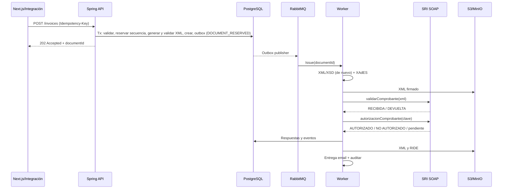

# 05 — Flujo de un comprobante electrónico

## Diagrama de secuencia

## Estados internos
Camino normal: `RESERVED -> GENERATED -> SIGNED -> SENDING -> RECEIVED -> AUTHORIZED`. Estados de fallo: `XSD_INVALID`, `SIGNATURE_FAILED`, `RETURNED` (la recepción del SRI lo devolvió) y `NOT_AUTHORIZED`. El estado que devuelve el SRI se guarda además literal en cada intento (`sri_attempts.sri_status`). La entrega al receptor no cambia el estado del comprobante: lleva el suyo en `deliveries`.

`SENDING` significa "hay un envío en curso o de resultado incierto"; `RECEIVED`, "el SRI lo tiene y falta su autorización". La espera entre reintentos no es un estado: se lleva en `next_attempt_at` y `attempt_count` del documento. Por eso no existen `AUTHORIZING`, `SRI_PROCESSING` ni `SRI_UNAVAILABLE`.

`DRAFT` es opcional y solo lo usa el editor del frontend: un borrador no tiene secuencial ni clave de acceso. Ambos se asignan en la misma transacción al pasar a `RESERVED` (doc 04). `POST /invoices` no pasa por `DRAFT`: valida y crea el documento directamente en `RESERVED`.

## Estado de implementación
Está implementado el primer tramo del diagrama: `POST /invoices` valida, calcula, reserva el secuencial con bloqueo de fila, genera la clave de acceso, **genera y valida el XML contra el XSD en la misma emisión** (la fila del secuencial sigue bloqueada mientras se construye y valida el XML, hasta confirmar; si no es válido responde `422 DOCUMENT_XML_INVALID` y no queda nada) y confirma en **una transacción** el documento en `RESERVED` con sus líneas, totales y pagos, el evento de estado (`NULL → RESERVED`), la auditoría, el registro de idempotencia y un evento `DOCUMENT_RESERVED` en `outbox_events` (el mismo para todos los tipos; la auditoría de la factura sigue llamándose `INVOICE_RESERVED`). El worker vuelve a validar el XML al generarlo. Si cualquier validación falla no queda nada: ni documento, ni secuencial consumido, ni evento.

También está implementado el tramo siguiente, como servicio (`DocumentProcessor.generateAndSign`): genera el XML versión 1.1.0 desde los datos congelados, lo valida contra el XSD y las reglas adicionales, lo guarda (`XML_UNSIGNED`) y pasa a `GENERATED`; después lo firma en XAdES-BES con el certificado activo del emisor, verifica la firma, guarda el XML firmado (`XML_SIGNED`) y pasa a `SIGNED`. Si el XML no es válido el documento queda en `XSD_INVALID` con el motivo; si no hay certificado utilizable o la firma no verifica, en `SIGNATURE_FAILED`, desde donde se puede reintentar. Es reentrante y bloquea el documento, de modo que procesarlo dos veces o en paralelo produce un solo XML firmado.

**El recorrido completo ya es automático.** Un relevo publica el `outbox` en RabbitMQ y un worker llama a `DocumentPipeline.advance`, que genera y firma, envía el XML firmado a la recepción del SRI y consulta la autorización hasta tener un resultado definitivo. Con la respuesta `AUTORIZADO` guarda el número y la fecha de autorización y conserva la respuesta íntegra como artefacto (`SRI_AUTHORIZATION`). Después se archiva y se entrega al receptor (ver "RIDE y entrega").

**Nada se ha transmitido todavía al SRI real.** Todas las pruebas usan un SRI simulado, y por defecto la aplicación no transmite: `SRI_ENABLED_ENVIRONMENTS` vacío deja los comprobantes en `SIGNED`. Hace falta una firma electrónica real y un RUC habilitado en el ambiente de certificación para comprobarlo (doc 12).

### Cómo se evita un doble envío
- El paso a `SENDING` y la apertura del intento se confirman en la base **antes** de llamar al SRI, y la llamada se hace fuera de toda transacción.
- Si la recepción no da una respuesta clara (timeout, corte, HTTP 5xx, respuesta ilegible) el documento sigue en `SENDING`. En el siguiente avance se pregunta al SRI por la clave de acceso: si la conoce, pasa a `RECEIVED`; **solo si no la conoce** vuelve a `SIGNED` y se reenvía el mismo XML.
- Si el proceso muere a mitad del envío, el intento queda abierto; pasado el plazo de envío (tiempos de espera más 30 segundos) se da por abandonado y se reconcilia igual.
- Una respuesta `DEVUELTA` con el código 43 (clave registrada) o 70 (clave en procesamiento) significa que el SRI ya tiene el comprobante: se trata como recibido, no como rechazo.
- Nunca se genera otra clave de acceso ni otro secuencial.

### Qué pasa si el worker no llega a procesar un comprobante
- Al emitir, la factura queda programada para retomarse a los 5 minutos. Si su evento se pierde, o el worker falla y el mensaje acaba en la cola de mensajes muertos, el planificador la devuelve a la cola.
- Un comprobante que queda en `XSD_INVALID` o `SIGNATURE_FAILED` **no** se reintenta solo: espera a que se corrija la causa (por ejemplo, cargar el certificado) y a un `POST /documents/{id}/retry`.

### Lo que no hace todavía
- **Corregir y reenviar con la misma clave** un comprobante `RETURNED` o `NOT_AUTHORIZED` (ficha, 5.10): no está implementado, porque los artefactos guardados son inmutables. Lo que sí existe desde el Plan 8b es **reemitir**: una factura nueva, con su propio secuencial y su propia clave, que reemplaza a la rechazada y queda enlazada con ella (`replacesDocumentId`). También se reemite un comprobante `XSD_INVALID`: no llegó al SRI y no admite reintento, porque con los mismos datos saldría igual. La factura nueva debe ser del mismo emisor que la reemplazada. El secuencial del comprobante rechazado no se reutiliza. Si la ficha exige otra cosa para el secuencial de un rechazado, hay que revisarlo antes de producción.
- Anulación, envío por lotes y consulta de validez.
- RIDE y entrega de otros tipos de comprobante (solo factura).

## Matriz de transición crítica
| Situación | Respuesta del sistema |
|---|---|
| XML no válido | Bloquear transmisión; devolver detalle técnico interno |
| Firma falla | No enviar, reintentar solo si error transitorio |
| SOAP recepción RECIBIDA | Consultar autorización, no marcar válido aún |
| SOAP recepción DEVUELTA | Registrar mensajes y aplicar política de corrección/reenvío documentada |
| Timeout después de enviar | **Consultar autorización por clave** antes de considerar retransmisión |
| SOAP autorización AUTORIZADO | Persistir XML/autorización, permitir entrega/descarga |
| SOAP autorización NO AUTORIZADO | Preservar respuesta y abrir flujo de resolución |
| SOAP autorización en proceso | Reconsultar con backoff y límite; no emitir otra clave. Agotado el límite, el comprobante deja de reintentarse solo y se reactiva con `POST /documents/{id}/retry` |
| Email falla | No alterar estado tributario, reintentar entrega |

## Idempotencia
Clave del cliente API: `(tenant, Idempotency-Key)` y hash de payload. Mismo cuerpo devuelve resultado anterior; cuerpo distinto implica 409. Comando worker usa `(documentId,action)` deduplicado con bloqueo/lease y eventos. Mantener hash de XML firmado y no firmar de nuevo con cambios inadvertidos.

## RIDE y entrega
El RIDE es una representación visual: **no sustituye al XML firmado**.

### Lo implementado
- **Archivo.** Al autorizarse un comprobante se guardan dos artefactos más: el **XML autorizado** (`xml-authorized`: los datos de la autorización del SRI y, dentro de una sección CDATA, el comprobante firmado byte a byte como se envió, de modo que su firma sigue verificando) y el **RIDE en PDF** (`ride`). Se descargan por `GET /documents/{id}/artifacts/{kind}` bajo el mismo control de acceso que el resto. La respuesta cruda del SRI sigue aparte (`sri-authorization`) como evidencia.
- **Inmutabilidad.** `document_artifacts` es de solo inserción: un disparador de la base rechaza `UPDATE`, `DELETE` y `TRUNCATE`. Protege frente a la aplicación y a errores, no frente a quien sea dueño de la tabla, que puede retirarlo (doc 10).
- **RIDE.** Tiene la disposición habitual de estos documentos —**pendiente de cotejar campo a campo con el modelo del Anexo 2 de la ficha, que es una imagen y no se pudo leer**—: emisor; RUC, número, número y fecha de autorización, ambiente, emisión y clave de acceso con código de barras (Code 128); adquirente; detalle; información adicional, formas de pago y totales por tarifa. Solo de factura.
- **Entrega por correo** (ficha, 4.7). Si el comprobante tiene correo del cliente, se crea una entrega automática y se envía un mensaje con el RIDE y el XML autorizado adjuntos. El remitente es la dirección de la plataforma con el nombre del emisor. Cada entrega queda registrada con destinatario, estado, intentos, último error y fecha de envío (`GET /documents/{id}/deliveries`), y se puede pedir otra a la misma o a otra dirección (`POST /documents/{id}/deliveries`).
- **La entrega no toca el estado fiscal.** Tiene su propio estado (`PENDING`, `SENDING`, `SENT`, `FAILED`); el comprobante sigue `AUTHORIZED` aunque el correo falle. `DELIVERY_PENDING`, `DELIVERED` y `DELIVERY_FAILED` no existen como estados del comprobante.
- **Reintentos.** Un fallo temporal (respuesta 4xx, conexión caída, tiempo de espera o un error imprevisto) se reintenta con espera creciente: 1 minuto que se duplica hasta 6 horas, 12 intentos (entre 16 y 25 horas). La espera se respeta aunque lleguen otros eventos del mismo comprobante. Un rechazo del servidor con código 5xx, o una dirección que no es una sola dirección válida, es definitivo. Agotados los intentos la entrega acaba en `FAILED` y se puede pedir otra.

### Límites que conviene conocer
- **Por defecto no se envía ningún correo** (`DELIVERY_EMAIL_ENABLED=false`): el comprobante se archiva y nada más. Nunca se ha enviado un correo a un servidor real; las pruebas usan un servidor SMTP simulado.
- **`SENT` significa que el servidor de correo aceptó el mensaje**, no que el cliente lo recibió. No hay detección de rebotes.
- **Entrega al menos una vez.** Si el proceso muere justo después de que el servidor acepta el mensaje, el correo se repite al vencer el plazo de envío (10 minutos). También se repite si un envío tarda más que ese plazo.
- **RIDE sin verificación visual automática.** Las pruebas comprueban su texto y su estructura, no su aspecto: conviene abrir uno (`target/ride-ejemplo.pdf` tras ejecutar las pruebas) antes de darlo por bueno. Usa Helvetica, así que los caracteres fuera del alfabeto latino se omiten; no lleva logotipo.
- **Comprobantes autorizados con el correo apagado:** al habilitar el correo no se envían solos; la entrega automática se crea la primera vez que se procesa una entrega de ese comprobante (por ejemplo, al pedir un reenvío).
- **Webhooks (Plan 6b):** cuando un comprobante pasa a `RECEIVED`, `AUTHORIZED`, `RETURNED` o `NOT_AUTHORIZED`, o sale un correo de entrega, en la misma transacción se anota un aviso por cada suscripción activa de la empresa que pidió ese evento. Un planificador los devuelve a una cola propia (`webhook.deliver`) y un worker los envía; un receptor lento no retrasa ni al SRI ni al correo. El aviso tiene su propio estado: pase lo que pase con él, el comprobante no cambia. Vienen apagados (`EINVOICE_WEBHOOKS_ENABLED`). Formato, firma y reintentos, en el [doc 11](11-api-specification.md#webhooks-salientes); límites, en el [doc 10](10-security.md). `XSD_INVALID` y `SIGNATURE_FAILED` no se avisan.

## Fuentes oficiales y control de cambios
- [SRI — Facturación electrónica](https://www.sri.gob.ec/facturacion-electronica): ficha técnica esquema off-line v2.34 (julio 2026), XSD y normativa.
- [SRI — registro de proveedores (28-07-2026)](https://www.sri.gob.ec/detalle-noticias?idnoticia=1318&marquesina=1): Resolución NAC-DGERCGC26-00000027.
- [SRI — adhesión y firma](https://www.sri.gob.ec/herramienta-de-comprobantes-electronicos).

> **Límite jurídico/técnico:** estos documentos son una especificación de ingeniería, no sustituyen los XSD oficiales, la ficha técnica integral, las resoluciones publicadas en Registro Oficial ni asesoría tributaria. Antes de pasar a producción, congelar versiones de normativa, XSD y catálogos, y ejecutar la matriz de conformidad con el ambiente de certificación del SRI. El detalle y fechas de entrada en vigor de cada reforma deben corroborarse en su texto normativo publicado.
