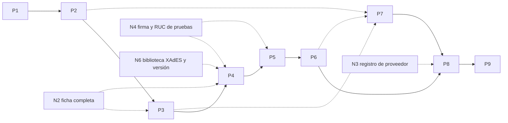

# Plan maestro de desarrollo — Facturación electrónica Ecuador

**Objetivo:** llevar la especificación de `docs/` a un SaaS multiempresa que emite, firma, transmite al SRI, archiva y entrega facturas electrónicas (`01`), y dejarlo listo para ampliar a otros comprobantes.

**Arquitectura:** monolito modular Spring Boot más workers, PostgreSQL como fuente de verdad, RabbitMQ con outbox transaccional, Redis, S3/MinIO y frontend Next.js (doc 03).

**Especificación:** [README](../../../README.md), [DEVELOPMENT](../../DEVELOPMENT.md) y documentos 01 a 14 de `docs/`.

La especificación cubre varios subsistemas independientes, así que el desarrollo se divide en **nueve planes** (más los que se han ido intercalando: 6b, 7b y 8b). Cada uno entrega software que funciona y se prueba por sí solo. Solo el primero está detallado tarea por tarea; los siguientes se detallan justo antes de empezarlos, en esta misma carpeta, porque dependen de decisiones y hallazgos de los anteriores.

## Planes

| Plan | Etapa (DEVELOPMENT §3) | Alcance | Docs | Depende de | Tamaño | Entregable verificable |
|---|---|---|---|---|---|---|
| **P1 Fundación** — [detalle](2026-10-10-p1-fundacion.md), implementado; el CI corre desde el 2026-10-12 | 0 técnica, 1 | Repositorio, backend base, compilación y validación XSD sin red, reglas fuera del XSD, clave de acceso, infraestructura local, `schema_registry`, CI | 03, 06, 10, 12, 13, 14 | — | M | CI verde: 4 XSD compilan sin acceso externo, vectores de clave pasan, health con PostgreSQL/RabbitMQ/Redis |
| **P2 Identidad y multiempresa** — [detalle](2026-10-10-p2-identidad-multiempresa.md), implementado | 2 | OIDC, tenants, memberships y RBAC, emisores con RUC único, establecimientos, puntos de emisión, auditoría, contrato OpenAPI inicial | 04, 10, 11 | P1 | M | `TenantIsolationIT`: un usuario del tenant A recibe 404 sobre recursos de B; RUC duplicado devuelve 409 |
| **P3 Catálogos, factura y secuenciales** — [detalle](2026-10-10-p3-catalogos-factura-secuenciales.md), implementado | 3 | Clientes, productos, tarifas de IVA por código del catálogo (sin vigencias por fecha: la ficha no las da), cálculo con BigDecimal, `POST /invoices` hasta `RESERVED`, secuenciales, idempotencia, outbox | 01, 04, 05, 06, 11 | P2, N2 | L | `SequenceConcurrencyIT` (100 facturas, 2 workers, sin repetidos), `TaxRoundingTest`, 409 por idempotencia. Cierra el Sprint 1 |
| **P4 XML y firma** — [detalle](2026-10-10-p4-xml-y-firma.md), implementado; aceptación del SRI pendiente | 4 | Generador XML de factura por versión, validación completa, carga y custodia del P12, firma XAdES-BES y verificación | 07, 10, 14 | P3, N2, N4, N6 | L | `XadesSignatureIT` y un XML firmado aceptado por el SRI (`SRI_CERT_ACCEPTED_FIXTURE`) |
| **P5 Integración SRI** — [detalle](2026-10-11-p5-integracion-sri.md), implementado contra un SRI simulado; certificación real pendiente | 5 | Clientes SOAP desde WSDL, máquina de estados, workers, reintentos, reconciliación y DLQ | 05, 08, 09 | P4, N4 | L | `RECIBIDA` y `AUTORIZADO` reales en certificación; `AuthorizationReconcileIT` resuelve un timeout sin duplicar |
| **P6 RIDE, archivo y entrega** — [detalle](2026-10-12-p6-ride-archivo-entrega.md), implementado sin webhooks; correo probado solo contra un SMTP simulado | 6 | RIDE en PDF, artefactos inmutables con hash, correo y entregas (los webhooks pasan a un plan propio, P6b) | 05, 11 | P5 | M | `DeliveryRetryIT`; descarga de XML y RIDE. Con P4 y P5 cierra el Sprint 2 |
| **P6b Webhooks** — [detalle](2026-10-16-p6b-webhooks.md), implementado; apagado por defecto | — | Suscripciones por empresa, avisos firmados de recepción, autorización, rechazo y entrega, con reintentos, historial y pantalla | 05, 10, 11 | P6, P8b | M | `WebhookDeliveryIT`, `WebhookSenderTest`, `PipelineEndToEndIT` (de emitir a recibir el aviso) |
| **P6c Mejoras de los webhooks** — [detalle](2026-10-19-p6c-mejoras-webhooks.md), implementado | — | Aviso de prueba, purga del historial de avisos y como mucho dos envíos a la vez por empresa | 10, 11 | P6b | S | `WebhookTestIT`, `WebhookHistoryPurgeIT`, `WebhookFairnessIT` |
| **P7 Frontend** — [detalle](2026-10-13-p7-frontend.md), implementado; su prueba de extremo a extremo es el Plan 7b | 7 | Next.js: onboarding de emisor y certificado, catálogos, editor de factura con borradores, monitor SRI, descargas; cliente TypeScript generado del OpenAPI | 01, 11 | P2 para empezar; P3 y P6 para completar | L | Prueba end-to-end: emitir hasta `AUTORIZADO` contra staging |
| **P7b Pruebas con navegador** — [detalle](2026-10-17-p7b-pruebas-navegador.md), implementado; solo Chromium y contra un SRI simulado | — | Recorrido completo en un navegador contra el jar de la API y la compilación de producción de la web: alta, emisión hasta `AUTORIZADO`, descargas, correo, rechazo y reemisión, equipo, avisos y sesión; revisión de las pantallas a la vista | 05, 11, 12 | P6b, P7, P8b | M | `npm run e2e` en `/e2e`, también en CI |
| **P7c Pulido de pantallas y teléfono** — [detalle](2026-10-18-p7c-pulido-pantallas.md), implementado | — | Lo que encontró la revisión de las pantallas del Plan 7b (decimales, catálogos, tarifa de IVA, alineación, titular del certificado) y que la aplicación quepa en un teléfono | 15 | P7b | S | `movil.spec.ts`: ocho pantallas sin desplazamiento lateral a 375 px |
| **P8 Certificación y producción** — [detalle](2026-10-14-p8-certificacion-produccion.md), implementado; G1 cumplido en local, G2 y G4 parciales, G3, G5 y G6 abiertos ([estado](../../15-produccion.md)) | 8 | Matriz del doc 12, revisión de seguridad, backup y restauración, observabilidad, pipeline de despliegue, activación por tenant | 10, 12, 13 | P5, P6, P7, N3 | M | Gates G1 a G6 del doc 12 aprobados |
| **P8b Equipo, reemisión y deuda** — [detalle](2026-10-15-p8b-equipo-reemision-deuda.md), implementado | — | Miembros e invitaciones de una empresa, reemisión de comprobantes devueltos o no autorizados, deuda de las revisiones de P7 y P8 | 04, 05, 10 | P8 | M | `InvitationApiIT`, `TeamApiIT`, `InvoiceReissueIT`; recorrido en el navegador con dos usuarios |
| **P9 Ampliación** — **bloqueado**: faltan los XSD oficiales de los demás comprobantes | 9 | Notas de crédito y débito, retenciones, guías, liquidaciones, planes SaaS | 01, 02 | P8 | L por tipo | `RECIBIDA` y `AUTORIZADO` en certificación por cada tipo |

P7 puede avanzar en paralelo al backend desde que P2 publique el contrato OpenAPI. El resto es secuencial: cada plan consume lo que produce el anterior.

## Frente normativo (sin código, en paralelo)

Son tareas del responsable del producto. Varias bloquean planes concretos; conviene empezarlas ya.

| ID | Tarea | Bloquea |
|---|---|---|
| N1 | Descargar el ZIP oficial de XSD de factura y `xmldsig-core-schema.xsd` de W3C, contrastar hashes con el [registro](../../xsd-source-registry.csv) y actualizarlo | Estado `VALIDADO` del registro (no bloquea P1) |
| N2 | (Hecho en parte: catálogos de identificación, IVA y formas de pago, límite de consumidor final y reglas de cálculo, ya incorporados en P3.) Obtener la ficha técnica v2.34 completa y extraer: catálogos (IVA, identificación, formas de pago), parámetros exactos de firma, mensajes de error y campo del RUC del proveedor | P3 (catálogos), P4 (firma) |
| N3 | Obtener el texto de la Resolución NAC-DGERCGC26-00000027 y su fecha en Registro Oficial; calcular los plazos de 30 y 60 días hábiles; registrar al proveedor en el RUC | P8 |
| N4 | Conseguir una firma electrónica para pruebas y un RUC habilitado en el ambiente de certificación del SRI | P4, P5 |
| N5 | Responder las preguntas abiertas de [DEVELOPMENT §8](../../DEVELOPMENT.md#8-preguntas-abiertas-antes-de-desarrollo-productivo) | P8; la de custodia de firma, P4 |
| N6 | Elegir la versión de esquema de factura que emitirá el MVP y la biblioteca XAdES, y validarlas con un comprobante aceptado | P4 |

## Decisiones ya tomadas

- **Build:** Maven con wrapper, un solo módulo `backend`.
- **Paquete raíz:** `com.example.einvoice` (doc 03); renombrarlo es un cambio mecánico si se define el nombre real antes de P2.
- **Unicidad fiscal:** un RUC pertenece a un solo tenant; borradores sin secuencial ni clave (doc 04).
- **XSD:** copia de `xmldsig-core-schema.xsd` junto a cada versión y resolver local de allowlist cerrada (doc 14).
- **CI:** GitHub Actions.
- **Spring Boot 4.x:** P1 generó el proyecto con 4.1.1 porque Spring Initializr ya no ofrece la línea 3.x.
- **Frontend:** se inicia en P7, no en P1, porque depende del contrato OpenAPI que nace en P2.
- **Pruebas con navegador (P7b):** paquete aparte (`e2e/`) con Playwright, fuera de la web; infraestructura propia y sin datos persistentes, aislada de la de desarrollo; API y web en la propia máquina para que el proveedor de identidad tenga una sola dirección; SRI simulado en Node guionizado por RUC, que hace también de receptor de avisos; reino de Keycloak derivado del de desarrollo con fichas de 60 segundos; selectores por rol y nombre accesible; lo que las pruebas encuentran se corrige en su capa con una prueba que falle primero.
- **Mejoras de los webhooks (P6c):** el aviso de prueba es un aviso más (firmado, por la misma cola, en el historial) pero sin comprobante y con un solo intento, uno a la vez por suscripción; como mucho dos envíos en curso por empresa, con un candado de transacción por empresa al reservar; el historial terminado se purga a los 90 días; el acceso de máquina a la API queda para otro plan.
- **Webhooks (P6b):** apagados por defecto; solo `https` a direcciones públicas, comprobadas al registrar y en cada envío, con la conexión fijada a la dirección comprobada y sin leer la respuesta más allá de su línea de estado; firma según la convención Standard Webhooks, con secreto generado por el servidor, mostrado una vez, cifrado en reposo y rotable con 24 horas de solape; el aviso lleva solo identificadores y estado; cola propia en RabbitMQ; 14 intentos en unas 26 horas, y apagado automático de la suscripción cuando acumula 100 fallos seguidos y lleva más de 3 días fallando.
- **Equipo, reemisión y deuda (P8b):** invitación por enlace de un solo uso ligado a un correo, del que se guarda solo la huella y que comparte quien invita; nadie concede un rol igual o superior al suyo y el propietario no se toca; retirar borra la membresía; un comprobante rechazado no se corrige ni se reenvía con su clave, se emite otro que lo reemplaza y ambos quedan enlazados; bitácora e historia de estados de solo inserción.
- **Certificación y producción (P8):** paso a producción por emisor en autoservicio, con evidencia que el sistema comprueba y la declaración del propietario, sin rol de operador de la plataforma; métricas con ficha propia; límite de peticiones por usuario en Redis que deja pasar si Redis cae; verificación periódica de la huella de los artefactos; roles de base separados como script para producción; política de contenido con nonce; imágenes sin root y un compose de referencia, sin publicar ni desplegar; la certificación real es un perfil de Maven que solo corre a petición.
- **Frontend (P7):** Next.js con sesión en el servidor (*backend for frontend*): tokens solo en cookies cifradas `httpOnly` y un único proxy hacia la API; cliente tipado generado del contrato; borradores de factura en el navegador (la API no tiene estado `DRAFT`); monitor por sondeo; sin biblioteca de componentes; Keycloak solo como proveedor de identidad de desarrollo; sin pruebas automatizadas con navegador.
- **RIDE, archivo y entrega (P6):** RIDE en PDF con OpenPDF (LGPL/MPL); XML autorizado construido con los datos guardados y el XML firmado propio; artefactos de solo inserción impuestos por la base; la entrega vive en `deliveries` y no cambia el estado fiscal; correo por SMTP apagado por defecto, con STARTTLS obligatorio, al menos una vez, con reintentos programados en la base (12 intentos, unas 20 horas); tope de 10 entregas por comprobante; webhooks fuera de este plan.
- **Integración SRI (P5):** cliente SOAP propio sobre el cliente HTTP del JDK, cotejado con los WSDL oficiales (sin clases generadas); un único punto de avance (`DocumentPipeline.advance`) con las llamadas al SRI fuera de transacción; un envío incierto se reconcilia consultando la autorización antes de reenviar; reintentos programados en la base y devueltos a la cola por un planificador (sin colas diferidas ni cola de reconciliación aparte); por defecto no se transmite (`SRI_ENABLED_ENVIRONMENTS`); `RETURNED` y `NOT_AUTHORIZED` no tienen aún flujo de corrección y reenvío.
- **XML y firma (P4):** factura versión 1.1.0; firma XAdES-BES construida sobre el JDK según el Anexo 14 de la ficha, sin biblioteca externa; certificado cifrado en PostgreSQL con una clave maestra por variable de entorno; artefactos XML en PostgreSQL; el procesamiento hasta `SIGNED` es un servicio que P5 conectará al `outbox`.
- **Facturación (P3):** catálogos como datos sembrados de la ficha; un contador de secuenciales por punto de emisión, ambiente y tipo; emiten `OWNER`, `ADMIN` y `BILLER`; el documento congela los datos de cliente y líneas; identificaciones validadas solo por formato; fecha de emisión no futura ni anterior al último comprobante del punto; pagos obligatorios e iguales al total.
- **Identidad (P2):** la API es un resource server OAuth2 sin sesiones propias; el tenant activo se elige con la cabecera `X-Tenant-Id` verificada contra las membresías; roles `OWNER`, `ADMIN`, `BILLER`, `AUDITOR`; el RUC se valida solo por formato hasta tener la ficha.

## Decisiones abiertas

- **Nombre real del paquete y del producto.**
- **Proveedor de identidad OIDC** concreto (cualquiera sirve: se configura con `OIDC_ISSUER`) y **proveedor de nube/KMS** (P4, P8).
- **Transferencia de la propiedad de una empresa:** el rol de propietario no se concede ni se cambia desde la aplicación; falta decidir cómo se transfiere.
- **Secuencial de un comprobante rechazado:** hoy no se reutiliza; falta confirmar con la ficha (5.10) si debe poder corregirse y reenviarse con la misma clave.
- **Aprobación del proveedor para pasar a producción:** hoy la activa el propietario de la empresa con evidencia; falta decidir si el proveedor debe aprobar cada emisor.
- **Nube, registro de imágenes y recogida de métricas y registros:** sin elegir; de ellos dependen el despliegue real, los respaldos programados y las alertas.
- **Gestor de claves (KMS) y almacenamiento de objetos** para producción: hoy la clave maestra es una variable de entorno y los XML viven en PostgreSQL.
- **Almacenamiento de objetos para desarrollo** (antes de P4): la imagen comunitaria de MinIO ya no se publica en Docker Hub ni en Quay (comprobado el 2026-10-10); ver doc 13.

## Correspondencia con los sprints de DEVELOPMENT

- **Sprint 1 (§5):** P1 + P2 + P3. Los tres están implementados y pasan en CI.
- **Sprint 2 (§6):** P4 + P5 + P6, más el monitor y las descargas de P7.

## Reglas para todos los planes

Las diez reglas de [DEVELOPMENT §4](../../DEVELOPMENT.md#4-reglas-de-implementación-que-un-asistente-de-código-debe-seguir) aplican a cada tarea. Además: cada tarea termina con sus pruebas en verde y un commit; ningún plan se da por cerrado sin su entregable verificable ejecutado, y la documentación de `docs/` se actualiza en el mismo commit que cambia una decisión.
